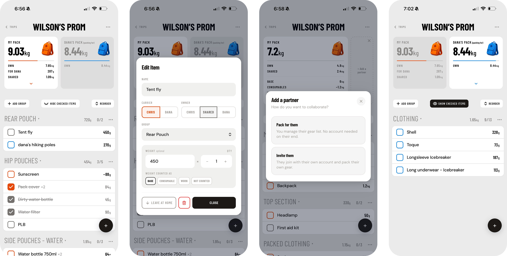
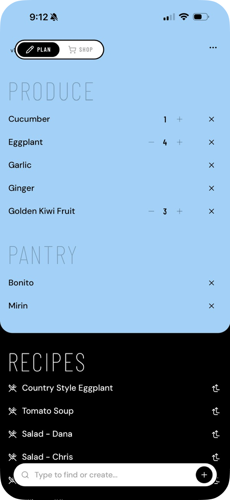
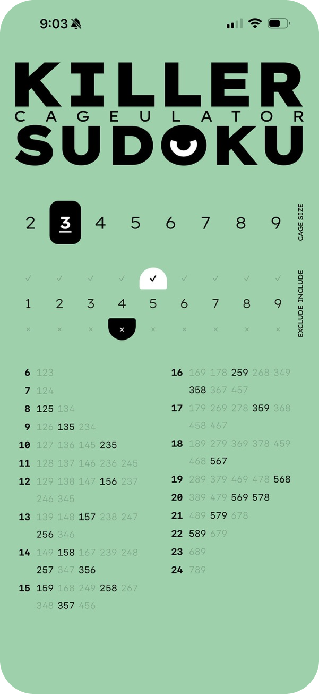

# Chris Kirby
 
Product designer in Melbourne. I lead design for Medibank's virtual GP service, and in my own time I build small apps end to end with React, Supabase and Claude Code.
 
---
 
## 2Pack
 
A shared packing list for two people going on a hike together. Each person packs their own gear, sees their partner's pack in real time, and can move items between packs as plans change. Weight tracking shows how much each person is carrying, including how shared gear is distributed between partners.
 
**[2pack.app](https://2pack.app)** · sign-in required
 

  

React · Vite · Tailwind · Supabase (Postgres, Realtime, OTP auth) · Vercel
 
---
 
## Weakly Shop
 
A weekly grocery list for households who cook the same things most weeks. Add a recipe and it puts what you need on the list, checks with you about pantry staples you might already have, and skips anything that’s already there. In the store, the list is sorted by aisle, and ticking an item off updates for everyone.
 
**[weaklyshop.app](https://weaklyshop.app)** · sign-in required
 

  

React · Vite · Tailwind · Supabase (Postgres, Realtime, OTP auth) · PWA · Vercel

---

## Killer Sudoku Cageulator

A calculator for killer sudoku players. Pick a cage size, mark digits you know are in or out, and it shows every possible combination for each cage total, with the ones that still fit highlighted.

**[Try it](https://2pack.app/labs/killersudoku/index.html)**

A single HTML file, built with Claude Code.
