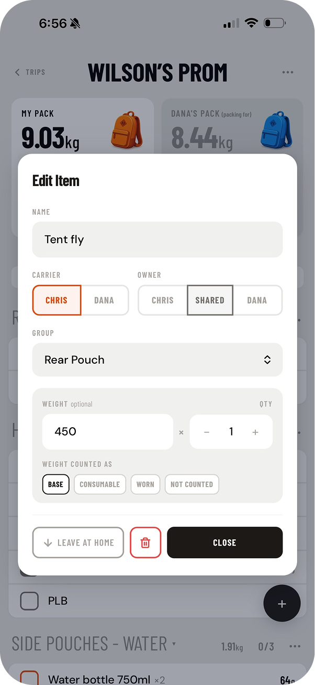
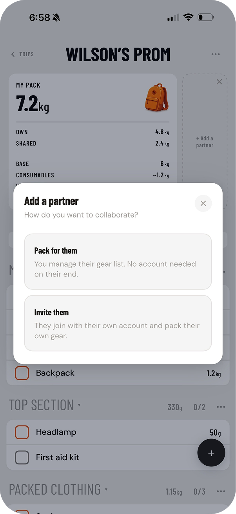
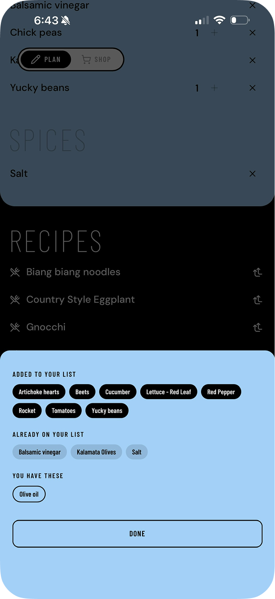
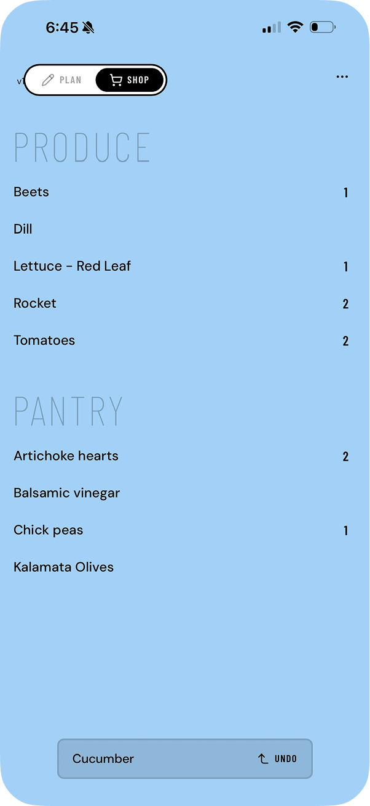

# Chris Kirby
 
Product designer in Melbourne. I lead design for Medibank's virtual GP service, and in my own time I build small apps end to end with React, Supabase and Claude Code. The code is private; here's what the apps are.
 
---
 
## 2Pack
 
A shared packing list for two people going on a hike together. Each person packs their own gear, sees their partner's pack in real time, and can move items between packs as plans change. Optional weight tracking shows base, consumable and worn weight for each person.
 
**[2pack.app](https://2pack.app)** · sign-in required
 

  
  
  

React · Vite · Tailwind · Supabase (Postgres, Realtime, OTP auth) · Vercel
 
---
 
## Weakly Shop
 
A weekly grocery list for households who cook the same things most weeks. Add your regular recipes and the list builds itself, sorted by store aisle. It only asks about the items you might already have at home. In the store, tap an item to tick it off; everyone on the list sees it update live.
 
**[weaklyshop.app](https://weaklyshop.app)** · sign-in required
 

  
  
  

React · Vite · Tailwind · Supabase (Postgres, Realtime, OTP auth) · PWA · Vercel
